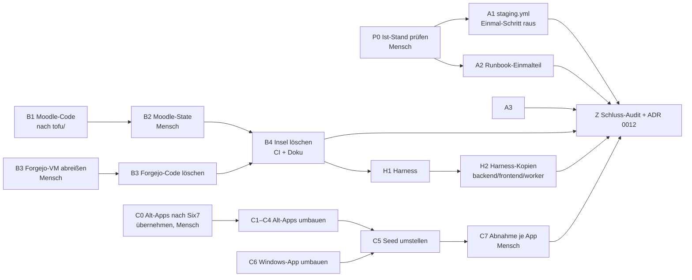

# Plan — Umstieg auf ausschließlich OpenTofu abschließen

**Stand der Erhebung:** 21.10.2026, gegen `origin/main` (Six7-app-store) aller Repos
**Grundlage:** [ADR 0010](adr/0010-opentofu-statt-terraform-und-packer.md),
[ADR 0011](adr/0011-deploy-wartet-auf-die-einrichtung-der-vms.md),
[deploy-runbook.md](deploy-runbook.md)
**Für:** Coding-Agenten und die Menschen, die sie koordinieren

Dieser Plan zerlegt den Rest des Umstiegs in Arbeitspakete, die verschiedene
Agenten unabhängig voneinander abarbeiten können. Jedes Paket nennt Repo,
Rolle, Abhängigkeiten, Schritte und ein prüfbares „fertig, wenn".

---

## 1. Ziel

Ab Abschluss gilt in der gesamten Plattform:

- Infrastruktur wird **nur mit OpenTofu** verwaltet. Weder Terraform noch
  Packer ist in einem Image, einem Workflow, einem Skript oder auf der
  Runner-VM installiert oder wird dort aufgerufen.
- **Jede App im Seed ist deploybar.** Sie bringt `tofu/` mit `*.tofu` mit und
  richtet ihre VM per cloud-init ein (App-Vertrag aus ADR 0010).
- Die Doku beschreibt den Ist-Zustand. Historische ADRs bleiben unverändert.

**Nicht Ziel:** Rückwärtskompatibilität zu Terraform (bewusst ausgeschlossen
durch ADR 0010). Ebenfalls nicht Ziel ist das Umbenennen von Namen, die
OpenTofu selbst so führt (siehe Abschnitt 6, „Erlaubte Reste").

---

## 2. Ausgangslage

### Schon erledigt (auf `origin/main`, nicht nacharbeiten)

| Repo | Stand | Beleg |
|---|---|---|
| worker | Nur OpenTofu 1.13.1 im Image, Packer-Executor und Build-Lock entfernt, Alt-Repos werden abgelehnt | `Dockerfile`, `app/services/tofu_executor.py`, `app/tasks.py` (`_resolve_tofu_dir`) |
| backend | Eine Variablenquelle `tofu`, 422 bei Alt-Repos, Migration `661aa473b510` | `app/routers/apps.py` ab Z. 1177 |
| frontend | Eine Variablenkarte statt Packer- und Terraform-Spalte | — |
| deployment | Staging unter `infrastructure/tofu/`, `staging.yml` mit `opentofu/setup-opentofu`, Forgejo-Job-Image mit `tofu` | ADR 0010 |
| Six7-app-store/Ubuntu-App, template-app, group-network-app, Kali-Linux-App, VSCode-App, Docker-App, Kubernetes-App | Haben nur `tofu/` | GitHub, Stand 21.10. |

### Offen

| # | Befund | Beleg |
|---|---|---|
| O1 | **Terraform-Übergangsinsel:** `infrastructure/terraform/envs/moodle` und `envs/forgejo` verwalten laufende VMs weiter mit Terraform. Das Modul `openstack_vm` liegt doppelt vor (abgesehen von zwei Kommentarzeilen identisch). | `infrastructure/README.md`, ADR 0010 „Übergangsinsel" |
| O2 | `infra-qa.yml` installiert Terraform (`hashicorp/setup-terraform@v3`) für `fmt`/`validate` der Insel. | `.github/workflows/infra-qa.yml:85-97` |
| O3 | `staging.yml` enthält einen **einmaligen** Abriss-Schritt für den alten Terraform-Stack und einen Rückgriff auf `/var/lib/tf-state/staging/` beim Caddy-Backup. Beides ist ab dem ersten erfolgreichen Lauf ein No-op. | `.github/workflows/staging.yml`, Schritt „Alten Terraform-Stack abreissen" und `tf_alt=` im Caddy-Schritt |
| O4 | **Seed-Apps sind nicht deploybar.** `seed_data.py` zeigt auf `DHBW-AppStore/{Online-IDE, Ubuntu-App, Web-LaTeX, Jupyter-Notebook, pgAdmin}`. Alle fünf haben dort noch `packer/` + `terraform/`, und der Worker lehnt sie ab. Unser Account hat auf diesen Repos **kein Push-Recht**. | `seed/seed_data.py`, `gh api repos/DHBW-AppStore/<app>` |
| O5 | Seed-Einträge `GitLab-CE` und `Monitoring-Stack` zeigen auf `six7-click-n-deploy/...` → **HTTP 404**. | `seed/seed_data.py` |
| O6 | Für `Ubuntu-App` gibt es schon eine OpenTofu-Fassung, aber unter `Six7-app-store/Ubuntu-App` (Tags `v2.0.0`, `v2.0.1`), nicht dort, wohin der Seed zeigt. | GitHub |
| O7 | Harness erlaubt noch `terraform fmt/validate/plan`, `agent_guard.py` formatiert `.tf` mit `terraform fmt`, pr-review-Skill prüft `terraform fmt`. | `harness/permissions.json`, `harness/agent_guard.py:350-368`, `harness/skills/pr-review/SKILL.md:40` |
| O8 | Doku-Reste: Packer-Zeiten in `seed/app_descriptions/Ubuntu-App.md`, `terraform apply` in `GitLab-CE.md`, Moodle-Anleitung mit `terraform`-Befehlen, Einmal-Abschnitt im Runbook, Insel-Hinweise in `AGENTS.md`, `README.md`, `infrastructure/README.md`. | `git grep -niE "packer\|terraform" origin/main` |
| O9 | `Six7-app-store/Windows-App` hat noch `packer/` + `terraform/`. | GitHub; ADR 0001; `docs/pipeline.md:56-61` |
| O10 | **Org `DHBW-AppStore` läuft auseinander.** Ihre `main`-Stände von deployment, backend, frontend und worker haben ADR 0010 nicht. Sie haben aber eigene Commits, die Six7 fehlen (z. B. backend `390b822` „Verify Keycloak tokens with PyJWT"). Laut E6 wird sie **nicht** nachgezogen. Falls einer dieser Commits in Six7 gebraucht wird, ist das ein eigenes Paket außerhalb dieses Plans. | `git rev-list --count origin/main..dhbw/main`: deployment 8, backend 11, frontend 3, worker 9 |
| O11 | **Unbekannt:** Ob der einmalige Abriss aus O3 tatsächlich gelaufen ist und ob alte App-Deployment-VMs und `deployment_*`-Schemata wirklich weg sind. Das geht aus keinem Repo hervor. | — |

---

## 3. Entscheidungen

Agenten treffen diese Entscheidungen **nicht**. Ein Paket, das von einer
offenen Entscheidung abhängt, bleibt liegen, bis sie hier eingetragen ist.

### Getroffen (21.10.2026)

| ID | Frage | Entscheidung | Folgt daraus |
|---|---|---|---|
| E1 | Forgejo weiterbetreiben? | **Nein, Forgejo kommt raus.** VM abreißen, Code und Doku löschen. | B3 |
| E2 | Wo werden die DHBW-Alt-Apps umgebaut? | **In `Six7-app-store`.** Jede App, auf die der Seed heute in `DHBW-AppStore` zeigt, wird nach `Six7-app-store` übernommen und dort umgebaut. | C0, C1–C4, C5 |
| E4 | Kommen die Six7-OpenTofu-Apps in den Seed? | **Ja**, alle deploybaren Apps dürfen in den Seed. Auf Staging sind sie ohnehin schon eingetragen. | C5 |
| E5 | Windows-App? | **Bleibt und wird auf OpenTofu umgebaut** (`Six7-app-store/Windows-App`, normale Windows-11-VM). Eine ARIS-Erweiterung wurde nie gebaut und ist kein Thema. | C6 |
| E6 | Bekommt `DHBW-AppStore` den Stand? | **Nein.** Gearbeitet, gepusht und verlinkt wird **ausschließlich in `Six7-app-store`**. In `DHBW-AppStore` wird nichts gepusht, kein PR geöffnet und kein Link gesetzt. | Regel 5, C5, Z |
| E7 | Gilt ADR 0001 („keine Windows-Apps") noch? | **Nein. Windows-Apps werden unterstützt.** Ein neues ADR löst ADR 0001 ab. | C6, Schritt 8 |
| E3 | `GitLab-CE` und `Monitoring-Stack`: Der Seed zeigt auf `six7-click-n-deploy/GitLab-App` und `.../Monitoring-Stack` (eingetragen 29.06.2026, `20313d3`). Beide Repos existieren nicht (404). | **Aus dem Seed streichen**, samt `seed/app_descriptions/GitLab-CE.md` und `Monitoring-Stack.md`. | C5 |

### Noch offen

Keine. Alle Pakete sind freigegeben.

---

## 4. Regeln für alle Agenten

1. **Basis ist `origin/main`, nicht der lokale Checkout.** Die lokalen
   Arbeitskopien stehen auf alten Feature-Branches (Stand Ende September),
   vor ADR 0010. Vor jedem Paket:
   ```bash
   git fetch origin
   git switch -c <branch-aus-dem-paket> origin/main
   ```
   Uncommittete Änderungen anderer Leute nicht anfassen. Ist der Arbeitsbaum
   schmutzig, mit `git worktree add` arbeiten.
2. **Zuerst die `AGENTS.md` des Ziel-Repos lesen.** Befehle, Definition of
   Done und Fallen stehen dort und sind verbindlich.
3. **Ein Paket, ein Repo, ein Branch, möglichst ein Commit.** Pakete, die
   mehrere Repos betreffen, sind hier bereits pro Repo getrennt.
4. **Prüfungen laufen im Container** (`make shell-backend`, `make shell-worker`)
   bzw. mit `tofu` am Host nur für `fmt`, `init -backend=false`, `validate`
   und `test`.
5. **Verboten für Agenten:** `tofu apply|destroy|state|import`,
   `terraform apply|destroy|state|import`, Push auf `main`, Force-Push,
   **jeder Push, PR oder Link in die Org `DHBW-AppStore`** (Remote `dhbw`;
   Ziel ist ausschließlich `Six7-app-store`, E6), Lesen oder Schreiben von `.env`,
   `*.pem` und `*.key`. Pakete mit der Rolle **Mensch** führen Agenten nicht
   aus, auch nicht teilweise.
6. **Harness-Änderungen nur in `deployment/harness/`**, danach
   `make harness-sync` und `make harness-test`. Die erzeugten Kopien in
   backend, frontend und worker sind **eigene Commits in diesen Repos**.
7. **Architekturentscheidung → ADR im selben Commit.** Bestehende ADRs werden
   nicht geändert (`docs/adr/README.md`).
8. **Rückmeldung am Paketende:** Branch, Commit-Hash, ausgeführte Prüfungen
   mit Ergebnis, Abweichungen vom Plan, neu entdeckte Reste. Den Status in
   Abschnitt 7 pflegt **die koordinierende Person**, nicht der Agent. Sonst
   konkurrieren parallele Branches um dieselbe Datei.

### Rollen

| Rolle | Darf | Typischer Ausführer |
|---|---|---|
| **Code** | In einem Repo auf einem Branch ändern, lokal prüfen, Commit, Push auf Feature-Branch nach Freigabe | Coding-Agent |
| **Audit** | Nur lesen, Befundliste mit `datei:zeile` liefern | Review- bzw. Explore-Agent |
| **Mensch** | Echte Infrastruktur, State, Runner-VM, Merge auf `main`, Org-fremde Repos | Teammitglied mit Zugang |

---

## 5. Arbeitspakete

### Abhängigkeiten



**Sofort parallel startbar:** P0, A3, B1, B3 (Abriss), C0 und danach C1–C4,
C6, H1 vorbereitend (Merge erst nach B4).

---

### P0 — Ist-Stand der Umstellung prüfen

| | |
|---|---|
| Rolle | **Mensch** (Runner-VM, Horizon) |
| Repo | — |
| Abhängig von | — |

Schritte:

1. Auf der Runner-VM:
   ```bash
   ls -la /var/lib/tf-state/staging/      # erwartet: nur *.abgerissen-<datum>
   ls -la /var/lib/tofu-state/staging/    # erwartet: terraform.tfstate
   command -v terraform packer            # erwartet: Ausgabe nötig für B2, sonst leer
   ```
2. Letzter Lauf von „CD - Staging Deployment" grün? Log des Schritts
   „Alten Terraform-Stack abreissen" sagt „Kein alter Terraform-State"?
3. Horizon: keine VM eines Alt-App-Deployments übrig (Runbook, Schritt 1).
4. State-Datenbank der App-Deployments: keine `deployment_*`-Schemata aus
   Terraform-Zeit (Runbook, Schritt 3).

Fertig, wenn: Ergebnis der vier Punkte unter Abschnitt 7 eingetragen ist.
Ist ein Punkt negativ, zuerst den Runbook-Schritt nachholen, dann A1 und A2.

---

### A1 — Einmal-Abriss aus `staging.yml` entfernen

| | |
|---|---|
| Rolle | Code |
| Repo / Branch | deployment / `chore/staging-ohne-terraform-altlast` |
| Abhängig von | P0 positiv (alter State umbenannt, Lauf danach grün) |

Schritte:

1. Schritt „Alten Terraform-Stack abreissen (einmalig, ADR 0010)" vollständig
   entfernen. Der Kommentar dort sagt selbst, dass er danach entfernt werden kann.
2. Im Schritt „Caddy-Zertifikat der alten VM sichern" den Rückgriff auf
   `tf_alt=/var/lib/tf-state/staging/terraform.tfstate` samt Kommentar
   entfernen. `alt` kommt dann nur noch aus `tofu output`.
3. Kommentare, die nur den Umstieg erklären, kürzen. Kommentare zu
   `TF_VAR_*` bleiben (OpenTofu-eigener Name).

Prüfung: `actionlint` bzw. YAML-Parse im Container. `git grep -n "tf-state" .github` liefert nichts.
Fertig, wenn: Workflow ohne Terraform-Bezug außer `TF_VAR_*`, PR offen.

---

### A2 — Runbook und Seed-Beschreibungen bereinigen

| | |
|---|---|
| Rolle | Code |
| Repo / Branch | deployment / `docs/opentofu-reste` |
| Abhängig von | P0 (für den Runbook-Teil) |

Schritte:

1. `docs/deploy-runbook.md`: Abschnitt „Einmalig: Umstieg von Terraform auf
   OpenTofu" auf einen Satz mit Verweis auf ADR 0010 und das Datum des
   Abschlusses kürzen. Den Absatz zu `envs/moodle` und `envs/forgejo` passt B4 an.
2. `seed/app_descriptions/*.md`: Packer- und Terraform-Phasen durch die
   tatsächlichen Phasen ersetzen (`tofu apply`, danach `VM_SETUP` nach
   ADR 0011). **Keine Zeiten erfinden.** Unbekannte Dauern als „hängt von der
   Einrichtung ab" formulieren oder die Zeile streichen.
3. `docs/architektur.md:172`, `docs/dev-setup.md:299`: Formulierungen auf
   den Ist-Zustand bringen.

Prüfung: `git grep -niE "packer" origin/main -- seed docs ':!docs/adr'` zeigt
nur noch Stellen, die Packers Wegfall beschreiben.

---

### A3 — Kosmetik in backend und frontend

| | |
|---|---|
| Rolle | Code |
| Repo / Branch | backend / `chore/opentofu-wording`, frontend / `chore/opentofu-wording` (zwei Commits) |
| Abhängig von | — |
| Priorität | niedrig |

- backend `app/routers/apps.py:940,950`: „Terraform authors" bzw.
  „Terraform remains the only check" → OpenTofu.
- backend und frontend `.github/workflows/trigger-staging-deploy.yml:35`:
  Kommentar `terraform apply` → `tofu apply`.
- **Nicht ändern:** Alembic-Migration `661aa473b510` und ihre Tests sowie
  `d4e5f6a7b8c9` (Historie), die Ablehnungstexte für `packer/` und
  `terraform/`, `docs/review/frontend-review.md` (historischer Bericht).

Prüfung: Lint und Tests laut `AGENTS.md` des Repos.

---

### B1 — Moodle-Umgebung nach `infrastructure/tofu/` umziehen (Code)

| | |
|---|---|
| Rolle | Code |
| Repo / Branch | deployment / `feat/moodle-auf-opentofu` |
| Abhängig von | — (Merge erst zusammen mit B2) |

Schritte:

1. `infrastructure/terraform/envs/moodle/*.tf` nach
   `infrastructure/tofu/envs/moodle/*.tofu` verschieben (`git mv`, damit die
   Historie erhalten bleibt).
2. `module "vm"` bleibt `source = "../../modules/openstack_vm"` und trifft
   damit die OpenTofu-Kopie. **Ressourcen- und Moduladressen nicht
   umbenennen.** Ist eine Umbenennung unvermeidbar, braucht es einen
   `moved {}`-Block, sonst passt der State aus B2 nicht.
3. `backend.tofu`: `required_version = ">= 1.13.0"`, Pfad
   `/var/lib/tofu-state/moodle/terraform.tfstate` (eigenes Verzeichnis wie bei
   Staging, damit der alte State nie versehentlich überschrieben wird).
   Den Kommentar „Wie bei envs/staging …" an den heutigen Staging-Kommentar
   angleichen.
4. Lockfile erzeugen: `tofu -chdir=infrastructure/tofu/envs/moodle providers lock -platform=linux_amd64 -platform=windows_amd64 -platform=darwin_arm64`.
   Die Datei muss `registry.opentofu.org/...` führen, wie die von Staging.
5. `docs/moodle-infrastruktur.md`: Tabelle (Zeilen „Terraform", „State") und
   Abschnitt „2. VM anlegen" auf `tofu` und die neuen Pfade umstellen. Den
   Hinweis „Im Plan muss `0 to destroy` stehen" **unbedingt behalten**.
6. `infra-qa.yml`: Die vorhandenen Schritte für `infrastructure/tofu`
   erfassen `envs/moodle` automatisch, falls sie über `envs/*/` laufen. Sonst
   ergänzen. Den Terraform-Teil entfernt erst B4.

Prüfung:
```bash
tofu fmt -check -recursive infrastructure/tofu
tofu -chdir=infrastructure/tofu/envs/moodle init -backend=false -input=false
tofu -chdir=infrastructure/tofu/envs/moodle validate
```
Fertig, wenn: Prüfungen grün, PR offen **als Entwurf** mit Verweis auf B2.
Nicht mergen, bevor B2 den State umgezogen hat. Sonst zeigt `main` Code, der
zu keinem State passt.

---

### B2 — Moodle-State auf OpenTofu übernehmen

| | |
|---|---|
| Rolle | **Mensch** (Runner-VM, VPN) |
| Abhängig von | B1 (Branch auschecken) |

Die Moodle-VM **darf nicht neu gebaut werden**: Kursdaten liegen auf der
Instanzplatte (`docs/moodle-infrastruktur.md`).

Schritte (auf der Runner-VM, Arbeitskopie auf Branch aus B1):

1. Sichern:
   ```bash
   cp /var/lib/tf-state/moodle/terraform.tfstate ~/tfstate-moodle-vor-tofu-$(date +%F).json
   jq -r .terraform_version /var/lib/tf-state/moodle/terraform.tfstate
   ```
   Für genau diese Terraform-Version den passenden Migrationsleitfaden von
   OpenTofu lesen (opentofu.org → „Migrating from Terraform").
2. **Weg A, State übernehmen:**
   ```bash
   sudo mkdir -p /var/lib/tofu-state/moodle && sudo chown "$(id -u):$(id -g)" /var/lib/tofu-state/moodle
   cp /var/lib/tf-state/moodle/terraform.tfstate /var/lib/tofu-state/moodle/
   cd infrastructure/tofu/envs/moodle
   tofu init -input=false
   tofu plan -input=false -var "ssh_public_key=$(cat ~/moodle-deploy/deploy.pub)"
   ```
   Abbruchkriterium: Der Plan zeigt **irgendetwas außer** „No changes". Dann
   nichts anwenden, Weg B nehmen oder Rücksprache halten.
   Ist der Plan sauber: `tofu apply -refresh-only`. Damit schreibt OpenTofu
   den State einmal selbst.
3. **Weg B, Import (Rückfall):** leerer State, die vorhandenen Ressourcen per
   `import {}`-Block übernehmen (Keypair, Instanz, Security Group und Regeln,
   Interface-Attach; die IDs stehen im gesicherten Terraform-State). Die
   Import-Blöcke nach erfolgreichem Apply wieder entfernen. Gleiches
   Abbruchkriterium: Der Plan zeigt nur Imports, keine Änderungen.
4. Alten State nicht löschen, sondern umbenennen:
   `mv /var/lib/tf-state/moodle/terraform.tfstate{,.uebernommen-$(date +%Y%m%d)}`.
5. B1-PR freigeben und mergen.

Fertig, wenn: `tofu plan` gegen den neuen Pfad sagt „No changes", Moodle ist
erreichbar, und der LTI-Launch aus dem App Store funktioniert.

---

### B3 — Forgejo abschaffen (E1)

| | |
|---|---|
| Rolle | Mensch (Schritt 1) + Code (Schritte 2–3) |
| Repo / Branch | deployment / `chore/forgejo-entfernen` |
| Abhängig von | — |

Hintergrund: Forgejo war bis zum 18.09.2026 der Ort des Staging-Deploys. Seit
ADR 0002 übernimmt das ein self-hosted GitHub-Runner. Die VM läuft noch, wird
aber nicht mehr gebraucht.

1. *Mensch:* Prüfen, ob auf der Instanz etwas liegt, das es sonst nirgends
   gibt. Sie war ein Pull-Mirror von GitHub, also voraussichtlich nichts.
   Dann die VM mit dem vorhandenen Terraform-Code in
   `infrastructure/terraform/envs/forgejo` abreißen. Der State liegt beim
   Operator, der zuletzt `apply` gefahren hat. Ist er nicht mehr auffindbar:
   VM, Security Group, Keypair und Port in Horizon von Hand löschen. Danach
   die Namen der zugehörigen DNS-Einträge entfernen.
2. *Code:* löschen: `forgejo/`, `infrastructure/terraform/envs/forgejo/`,
   `infrastructure/ansible/forgejo.yml`,
   `infrastructure/ansible/inventory-forgejo.sh`. Alle Verweise in `README.md`
   (Z. 53 „Workflow im eigenen Forgejo", Z. 78 `.forgejo/workflows/`, das es
   nicht mehr gibt, Z. 82–83), `infrastructure/README.md` (Umgebungstabelle
   nennt Forgejo Actions als Staging-Trigger) und `docs/staging-setup.md`
   („Warum ein eigenes Forgejo") entfernen. Seit ADR 0002 läuft Staging über
   den self-hosted GitHub-Runner.
3. ADR anlegen (nächste freie Nummer): „Forgejo wird nicht weiterbetrieben".

Fertig, wenn: die VM weg ist und `git grep -ni forgejo` nur noch in ADRs trifft.

---

### B4 — Übergangsinsel löschen, CI und Doku nachziehen

| | |
|---|---|
| Rolle | Code |
| Repo / Branch | deployment / `chore/terraform-insel-aufloesen` |
| Abhängig von | B2 und B3 auf `main` |

Schritte:

1. `infrastructure/terraform/` vollständig löschen (inklusive der
   Modul-Kopie).
2. `.github/workflows/infra-qa.yml`: `hashicorp/setup-terraform@v3`,
   „Terraform Format" und „Terraform Validate" entfernen. Job-Name und
   Kommentar Z. 36 und 56 anpassen.
3. `.gitignore` und `infrastructure/.gitignore`: Einträge, die nur der Insel
   galten, entfernen. `.terraform/` bleibt (OpenTofu nutzt denselben Ordner).
4. `AGENTS.md`: Konvention „Übergangsinsel …" und „(und die
   Terraform-Übergangsinsel)" in der DoD streichen; „`tofu apply` (oder
   `terraform apply`)" → „`tofu apply`".
5. `README.md` (Baum Z. 75), `infrastructure/README.md` (Abschnitte
   Intro, Environments, Baum), `docs/deploy-runbook.md` (Absatz zu moodle und
   forgejo).
6. ADR (nächste freie Nummer, voraussichtlich 0012) „Die
   Terraform-Übergangsinsel ist aufgelöst": Datum, Weg A oder B aus B2 und
   die Abschaffung von Forgejo (E1). ADR 0010 bleibt unverändert. Zeile im
   Verzeichnis in `docs/adr/README.md` ergänzen. Ist B3 schon mit eigenem ADR
   gemergt, hier nur darauf verweisen.

Prüfung: `tofu fmt -check -recursive infrastructure/tofu`, `validate` je Env,
`git ls-files '*.tf'` ist leer.

**Mensch, danach:** Terraform-Binary auf der Runner-VM deinstallieren.
`/var/lib/tf-state/` nach einer vereinbarten Frist (Vorschlag: 30 Tage)
löschen.

---

### H1 — Harness ohne Terraform

| | |
|---|---|
| Rolle | Code |
| Repo / Branch | deployment / `chore/harness-ohne-terraform` |
| Abhängig von | B4 auf `main` (vorher würde `.tf` in der Insel unformatiert bleiben) |

Schritte, nur unter `deployment/harness/`:

1. `permissions.json`: Allow-Regeln `terraform fmt *`, `terraform validate *`,
   `terraform plan *` entfernen. **Deny-Regeln für `terraform apply|destroy|state|import` behalten.**
   Sie kosten nichts und sperren ein noch installiertes Binary am Entwicklerrechner.
2. `agent_guard.py`: den Zweig, der `.tf` mit `terraform fmt` formatiert
   (um Z. 350–368), und den Kommentar Z. 110 entfernen bzw. anpassen.
   Passende Fälle in `test_agent_guard.py` streichen oder auf `.tofu` umstellen.
3. `skills/pr-review/SKILL.md:40`: Zeile „Terraform unformatiert" →
   `tofu fmt -check -recursive infrastructure/tofu`.
4. `root/CLAUDE.md:36`: „(oder `terraform apply`)" streichen.
5. `permissions.json`: Deny-Regel `Bash(git push dhbw *)` ergänzen (E6). Damit
   scheitert ein versehentlicher Push in `DHBW-AppStore` hart. Mit Test in
   `test_agent_guard.py`, falls der Guard die Regel auswertet.
6. `make harness-test`, `make harness-sync`, `make harness-check`. Die
   erzeugten Kopien in deployment (`.claude/`) gehören in denselben Commit.

---

### H2 — Harness-Kopien in backend, frontend, worker

| | |
|---|---|
| Rolle | Code |
| Repo / Branch | je Repo `chore/harness-sync-opentofu` (drei Commits) |
| Abhängig von | H1 auf `main` |

Nach `make harness-sync` die geänderten `.claude/`-Dateien und `AGENTS.md`
in jedem der drei Repos als eigenen Commit aufnehmen. Kein Inhalt außer den
erzeugten Kopien.

---

### C0 — Alt-Apps nach `Six7-app-store` übernehmen (E2)

| | |
|---|---|
| Rolle | **Mensch** (legt Repos in der Org an) |
| Abhängig von | — |

Betroffen sind Online-IDE, Web-LaTeX, Jupyter-Notebook und pgAdmin.
Ubuntu-App **nicht**: `Six7-app-store/Ubuntu-App` ist schon auf OpenTofu.

**Kein GitHub-Fork, sondern eine Kopie mit Historie.** Ein Fork bleibt mit
`DHBW-AppStore` verknüpft, und `gh pr create` öffnet PRs dort standardmäßig
gegen das Original. Das widerspricht E6. Stattdessen je App:

```bash
gh repo create Six7-app-store/<App> --public
git clone --bare https://github.com/DHBW-AppStore/<App>.git
git -C <App>.git push --mirror https://github.com/Six7-app-store/<App>.git
rm -rf <App>.git
```

Fertig, wenn: die vier Repos in `Six7-app-store` existieren, mit Historie und
Tags, ohne Fork-Verknüpfung.

---

### C1–C4 — Alt-Apps auf den OpenTofu-App-Vertrag umbauen

Je App ein Paket, alle parallel, jeweils im Repo unter `Six7-app-store`:

| ID | App | Repo | Besonderheit |
|---|---|---|---|
| C1 | Online-IDE | `Six7-app-store/Online-IDE` | `aufgaben.zip` im Repo, Bereitstellung per cloud-init klären |
| C2 | Web-LaTeX | `Six7-app-store/Web-LaTeX` | `packer/scripts/provision.sh` ist **29 KB** → Größengrenze für `user_data` beachten (siehe unten) |
| C3 | Jupyter-Notebook | `Six7-app-store/Jupyter-Notebook` | eigene `cloud-init-multi-user.yml.tpl` |
| C4 | pgAdmin | `Six7-app-store/pgAdmin` | `user-data.yaml.tpl` schon 13 KB |

| | |
|---|---|
| Rolle | Code (in einem App-Repo) |
| Branch | `feat/opentofu` |
| Abhängig von | C0 |
| Vorbilder | `Six7-app-store/template-app` (Struktur, CI, Tests), `Six7-app-store/Ubuntu-App` (`users`-Variable, Basis-Image, cloud-init) |

Schritte:

1. Vorbild lesen: Baum und `README.md` von `template-app` (Abschnitt
   „Versionen und Migration"), `tofu/variables.tofu` und `tofu/main.tofu` von
   `Ubuntu-App`.
2. `terraform/*.tf` → `tofu/*.tofu` (`git mv`), Templates (`*.tpl`) mit
   nach `tofu/`.
3. Image: statt des von Packer gebauten Images das **Basis-Image** per
   `data "openstack_images_image_v2"` wählen (Vorbild: `image_name = "Ubuntu 24.04"`).
   Alle `image_name`-Variablen entfernen, die früher der Worker
   einspeiste.
4. Provisionierung: Inhalt von `packer/scripts/provision.sh` in cloud-init
   überführen (`packages`, `write_files`, `runcmd`). Reihenfolge und
   Idempotenz erhalten. Die Einrichtung muss in der seriellen Konsole als
   erfolgreich oder fehlgeschlagen erkennbar sein (ADR 0011, Worker-Phase
   `VM_SETUP`).
5. **`user_data`-Größe:** Nova begrenzt `user_data` auf 64 KiB (nach
   Base64). Bei C2 und C4 die Größe messen. Liegt sie in der Nähe, mit
   `data "cloudinit_config"` gzip- und base64-kodieren oder große Teile beim
   Boot aus dem Repo laden. Den Grenzwert vor dem Festlegen gegen die
   Nova-Doku der eingesetzten OpenStack-Version prüfen.
6. Variablen: `users` vom Worker übernehmen (wie Ubuntu-App). Den Marker
   `@platform:internal` entfernen. Annotationen wie `@openstack:flavor`
   übernehmen.
7. Löschen: `packer/`, `terraform/`, `.github/workflows/packer.yml`,
   `.github/workflows/terraform.yml`, `.github/actions/action.yml`, sofern nur
   von diesen genutzt.
8. CI: `.github/workflows/opentofu.yml` aus `template-app` übernehmen
   (`fmt -check`, `init -backend=false -lockfile=readonly`, `validate`,
   `test`, cloud-init-Prüfskript). `tofu/.terraform.lock.hcl` erzeugen.
   Mindestens einen `tofu test` schreiben.
9. `README.md` der App: Packer-Teil raus, Bootdauer ehrlich als „länger als
   früher, da Installation beim Start" beschreiben (ADR 0010, Konsequenzen).
10. Nach dem Merge: **neuen Release-Tag** setzen (Major-Sprung). Der Worker
    klont am Release-Tag. *(Mensch)*

Prüfung: CI des App-Repos grün. Lokal `tofu fmt -check -recursive tofu`,
`tofu -chdir=tofu init -backend=false`, `validate`, `test`.
Fertig, wenn: Repo enthält nur `tofu/`, `tests/` und `.github/`, und der Tag
ist gesetzt.

---

### C5 — Seed auf deploybare Apps umstellen

| | |
|---|---|
| Rolle | Code |
| Repo / Branch | deployment / `fix/seed-opentofu-apps` |
| Abhängig von | C1–C4 und C6 getaggt |

Schritte:

1. `seed/seed_data.py`: **jeder** `git_link` zeigt auf
   `https://github.com/Six7-app-store/<App>.git`. Danach darf
   `git grep -n "DHBW-AppStore\|six7-click-n-deploy" -- seed` nichts mehr
   finden.

   | App | Repo in `Six7-app-store` | Stand |
   |---|---|---|
   | Ubuntu-App | Ubuntu-App | schon OpenTofu (Tag `v2.0.1`) |
   | Online-IDE, Web-LaTeX, Jupyter-Notebook, pgAdmin | gleichnamig | nach C1–C4 |
   | Windows-App | Windows-App | nach C6 |
   | Kali-Linux-App, VSCode-App, Docker-App, Kubernetes-App, group-network-app | gleichnamig | schon OpenTofu (E4) |
   | GitLab-CE, Monitoring-Stack | — | **streichen** (E3), Beschreibungen löschen |

   `template-app` ist eine Vorlage und kommt nicht in den Seed.
2. Den Seed so schreiben, dass schon vorhandene Apps nicht doppelt
   angelegt werden (auf Staging sind die Six7-Apps schon eingetragen, E4).
   Falls `seed_data.py` das heute nicht tut, nach `git_link` oder Name
   abgleichen.
3. `seed/app_descriptions/`: zu jeder Seed-App eine passende Beschreibung,
   verwaiste löschen.
4. Den Seed im Dev-Stack ausführen (`make seed-data`) und prüfen, dass jede App
   unter `GET /apps/{id}/variables` **200** liefert und keinen 422-Fehler.

---

### C6 — Windows-App auf OpenTofu umbauen (E5)

| | |
|---|---|
| Rolle | Code |
| Repo / Branch | `Six7-app-store/Windows-App` / `feat/opentofu`; ADR in deployment / `docs/adr-windows-app` |
| Abhängig von | — |

Die Windows-App ist eine normale Windows-11-VM pro Studierendem mit RDP-Zugang
(`docs/pipeline.md`, Abschnitt „Die Windows-App"). Der Zielzustand ist dort
schon beschrieben:
`OpenTofu → je Nutzer eine VM aus dem Basis-Image Windows 11 25H2 (UEFI) → cloudbase-init`.

Schritte wie C1–C4, mit diesen Abweichungen:

1. Basis-Image `Windows 11 25H2 (UEFI)` per `data "openstack_images_image_v2"`.
   Vorher prüfen, dass dieses Image in OpenStack existiert und
   **cloudbase-init enthält**. Ohne cloudbase-init läuft kein `user_data`,
   und die VM bleibt uneingerichtet und unerreichbar (IPv6, siehe unten).
2. Was `packer/scripts/provision.ps1` (Chocolatey, Python, Node.js, Git,
   VS Code, Kursverzeichnis) und `bootstrap.ps1.tpl` ins Image gebacken haben,
   zusammen mit `terraform/windows-multi-user.ps1.tpl` in **ein**
   cloudbase-init-Skript in `user_data` überführen (`#ps1_sysnative`).
   `packer/scripts/cleanup.ps1` (Sysprep-Vorbereitung) entfällt, weil kein
   Image mehr gebaut wird. Die Größe gegen die `user_data`-Grenze messen
   (siehe C1–C4, Schritt 5); die Skripte zusammen haben heute rund 34 KB.
3. Die Reihenfolge aus `docs/pipeline.md` einhalten: Software, Konto mit
   Zufallspasswort, Gruppen, **IPv6 aus den Metadaten setzen**, RDP und
   Firewall. Ohne den IPv6-Schritt ist die VM im DHBW-Netz nicht erreichbar.
4. ADR 0011: Der Worker wartet über die serielle Konsole auf das Ende der
   Einrichtung. Prüfen, ob cloudbase-init dort eine erkennbare Abschluss-
   bzw. Fehlermeldung schreibt. Sonst greift die 10-Minuten-Regel („kein
   cloud-init sichtbar"), und der Worker wartet nicht auf die Windows-VMs.
   Das Ergebnis als Befund melden, nicht im Worker nachbauen.
5. Obergrenze zwölf VMs und Flavor (2 vCPU, 8 GB) beibehalten.
6. `README.md` der App: Abschnitte „VM-Deployment", „Deployment-Dauer" und
   „Stand der Erprobung" auf den neuen Ablauf bringen.
7. `deployment/docs/pipeline.md:56-61`: Satz „Das Windows-App-Repository ist
   noch auf dem alten Stand" entfernen (eigener Commit im deployment-Repo).
8. **ADR (E7):** neues ADR „Windows-Apps werden unterstützt", das ADR 0001
   ablöst. ADR 0001 bekommt nur den Status „Abgelöst durch ADR-NNNN", sonst
   bleibt es unverändert (`docs/adr/README.md`). ADR 0001 nennt die
   Lizenzlage als Ausschlussgrund. Das neue ADR muss sagen, wie damit
   umgegangen wird. Diese Begründung kommt vom Team; **nicht erfinden**.
   Fehlt sie, im Kontext als offene Stelle markieren
   (`<!-- TODO: ... -->`, wie in ADR 0001 schon üblich).

Fertig, wenn: das Repo nur `tofu/`, `tests/` und `.github/` enthält, die CI
grün ist und ein Tag gesetzt ist.

---

### C7 — Abnahme je App auf Staging

| | |
|---|---|
| Rolle | **Mensch** |
| Abhängig von | C5 auf `main`, Staging neu gebaut |

Je Seed-App: im App Store auf Staging deployen. Prüfen: Phase `VM_SETUP`
endet erfolgreich, die App ist erreichbar, und die Zugangsdaten stimmen.
Danach löschen und in Horizon nachsehen, dass nichts übrig ist. Bootdauer
notieren (Vergleichswert für die Beschreibungen aus A2).

---

### Z — Schluss-Audit

| | |
|---|---|
| Rolle | Audit, danach Code für Restfunde |
| Abhängig von | alle anderen Pakete |

```bash
for r in deployment backend frontend worker; do
  git -C $r fetch origin
  git -C $r grep -nIiE "packer|terraform" origin/main -- . \
    ':!docs/adr' ':!**/alembic/versions/**' ':!*.lock' ':!package-lock.json'
done
```

Jeden Treffer gegen die Liste „Erlaubte Reste" (Abschnitt 6) halten. Alles
andere als Befund mit `datei:zeile` melden. Zusätzlich:

- `git ls-files '*.tf' '*.pkr.hcl'` in allen Repos: leer
- `docker run --rm --entrypoint sh <worker-image> -c 'command -v terraform packer'`: leer
- Workflows: kein `hashicorp/setup-terraform`, kein `hashicorp/setup-packer`
- Jede App im Seed hat auf ihrem Tag ein `tofu/` und kein `packer/` oder `terraform/`
- Kein Link auf `DHBW-AppStore` oder `six7-click-n-deploy` in Seed, Doku oder
  Code, außer in ADRs und historischen Berichten

---

## 6. Erlaubte Reste

Diese Treffer sind korrekt und bleiben:

- OpenTofu-eigene Namen: `terraform { }`-Block, `TF_VAR_*`, `TF_LOG`,
  `.terraform/`, `.terraform.lock.hcl`, `terraform.tfstate`,
  Provider-Adresse `terraform-provider-openstack/openstack`
- ADRs 0001–0011 (historisch, werden nicht geändert)
- Alembic-Migrationen und ihre Tests
- Ablehnungstexte und Tests für Repos mit `packer/` oder `terraform/`
  (worker `tasks.py`, `tests/test_tasks_branches.py`; backend `apps.py` um Z. 1331)
- Deny-Regeln für `terraform apply|destroy|state|import` im Harness
- Historische Berichte (`frontend/docs/review/frontend-review.md`,
  `docs/user-story-audit-*.md`)

---

## 7. Status

Gepflegt von der koordinierenden Person.

| Paket | Status | Branch / PR | Notiz |
|---|---|---|---|
| E1–E7 | entschieden 21.10.2026 | — | siehe Abschnitt 3 |
| P0 | offen | — | |
| A1 | offen | | |
| A2 | offen | | |
| A3 | offen | | |
| B1 | offen | | |
| B2 | offen | | |
| B3 | offen | | |
| B4 | offen | | |
| H1 | offen | | |
| H2 | offen | | |
| C0 | offen | | |
| C1 Online-IDE | offen | | |
| C2 Web-LaTeX | offen | | |
| C3 Jupyter-Notebook | offen | | |
| C4 pgAdmin | offen | | |
| C5 | offen | | |
| C6 Windows-App | offen | | |
| C7 | offen | | |
| Z | offen | | |
